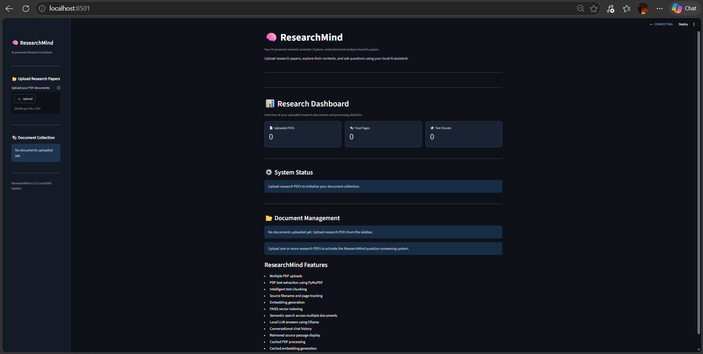
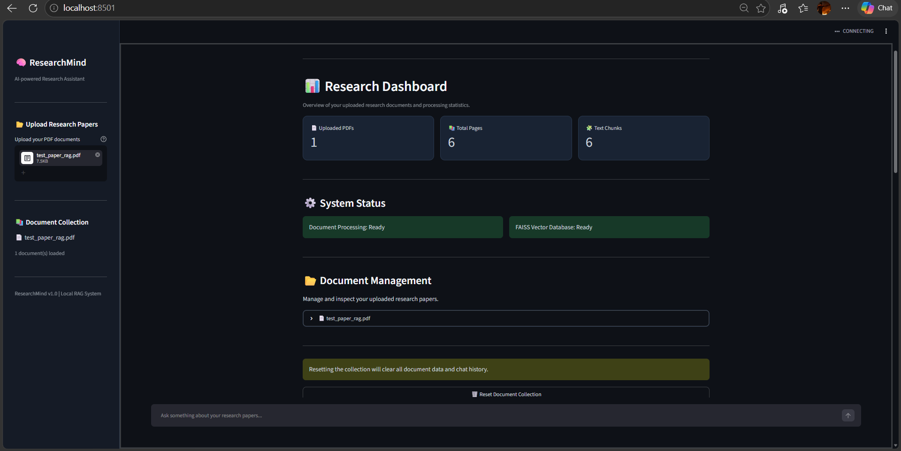
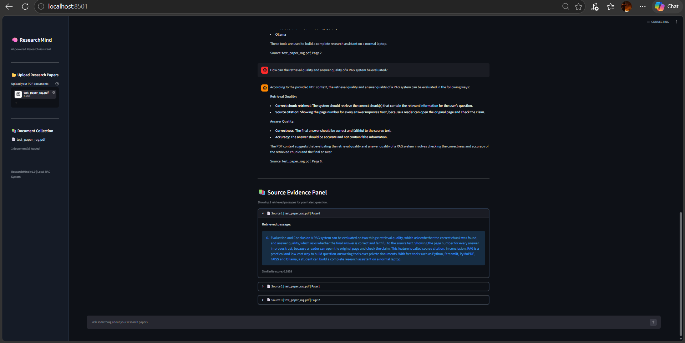

# 🧠 ResearchMind — Local AI Research Assistant

ResearchMind is a local Retrieval-Augmented Generation (RAG) application that allows users to upload PDF documents, ask questions in natural language, and receive answers grounded in retrieved document content.

It uses local embeddings, FAISS vector search, and Ollama to generate responses without requiring a paid AI API.

## ✨ Features

- Upload and process PDF documents.
- Extract text with PyMuPDF.
- Split documents into overlapping text chunks.
- Generate semantic embeddings using FastEmbed.
- Retrieve relevant passages using FAISS.
- Generate answers using a locally running Ollama model.
- Display source document names, page references, and retrieved evidence.
- Interactive Streamlit interface.

## 📸 Application Screenshots

### Dashboard


### Document Upload


### RAG Question Answering


## 🛠️ Tech Stack

| Technology | Purpose |
|---|---|
| Python | Core programming language |
| Streamlit | User interface |
| PyMuPDF | PDF text extraction |
| FastEmbed | Text embeddings |
| ONNX Runtime | Embedding inference |
| FAISS | Vector similarity search |
| Ollama | Local LLM inference |
| Llama 3.2 3B | Answer generation |

## 🏗️ Architecture

```text
PDF Upload
    ↓
PDF Text Extraction
    ↓
Text Chunking
    ↓
Embedding Generation
    ↓
FAISS Vector Index
    ↓
User Question
    ↓
Query Embedding
    ↓
Similarity Search
    ↓
Retrieved Context
    ↓
Ollama LLM
    ↓
Answer + Source Evidence
```

## 📂 Project Structure

```text
ResearchMind/
│
├── app.py
├── chunker.py
├── embedder.py
├── vector_store.py
├── requirements.txt
├── README.md
├── .gitignore
│
└── screenshots/
    ├── dashboard.png
    ├── document-upload.png
    └── rag-answer.png
```

## ⚙️ Installation and Setup

### 1. Clone the repository

```bash
git clone https://github.com/ajaypatil001136-cmd/ResearchMind.git
cd ResearchMind
```

### 2. Create a virtual environment

```bash
py -3.12 -m venv .venv
```

### 3. Activate the environment

**Windows PowerShell:**

```powershell
.venv\Scripts\Activate.ps1
```

### 4. Install dependencies

```bash
python -m pip install -r requirements.txt
```

### 5. Install and start Ollama

Install Ollama from https://ollama.com/

Download the model:

```bash
ollama pull llama3.2:3b
```

Ensure Ollama is running before launching the application.

### 6. Run ResearchMind

```bash
streamlit run app.py
```

Open the local Streamlit address displayed in your terminal, usually:

```text
http://localhost:8501
```

## 🧪 Testing

The application has been manually tested with a sample PDF. The tested workflow includes:

- PDF upload and text extraction.
- Text chunk creation.
- Embedding generation.
- FAISS similarity retrieval.
- Local LLM answer generation.
- Display of retrieved source evidence.

Formal retrieval-quality benchmarks and quantitative evaluation metrics have not yet been conducted.

## ⚠️ Current Limitations

- Scanned PDFs may require OCR.
- Retrieval similarity scores are not calibrated confidence scores.
- Formal RAG evaluation is not yet implemented.
- The application currently relies on a locally running Ollama installation.

## 🚀 Future Improvements

- OCR support for scanned documents.
- Retrieval evaluation and benchmarking.
- Reranking for improved retrieval relevance.
- Persistent vector storage.
- Automated testing and performance monitoring.

## 👨‍💻 About

ResearchMind is a portfolio project built to explore Retrieval-Augmented Generation, semantic search, vector databases, PDF processing, and local Large Language Models.

**GitHub Repository:**  
https://github.com/ajaypatil001136-cmd/ResearchMind